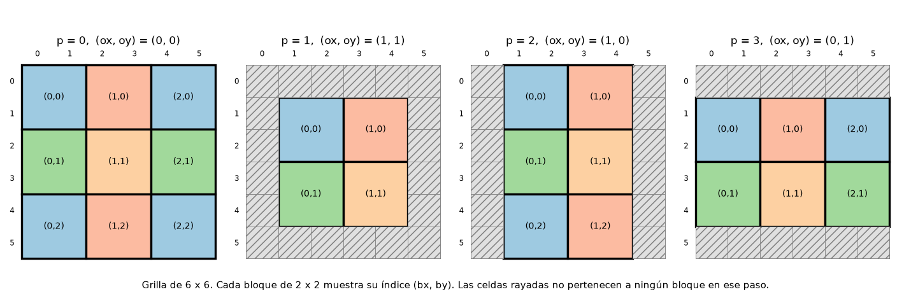

# TP2
{: .no_toc }

1. Índice
{:toc}

# Trabajo Práctico 2: Simulador de materiales ("falling sand")

## Introducción

Se evaluarán los siguientes conceptos:

* Programación funcional (el programa debe ser escrito en lenguaje Clojure)
* Programación orientada a eventos
* Interfaces gráficas
* Concurrencia

## Duración
3 semanas

## Lenguaje principal
Clojure

## Interfaz de usuario
JavaFX

## Grupos de Trabajo
Parejas. Se priorizará mantener el equipo del TP 1.

---

## 1. Consigna general

Desarrollar un simulador interactivo de materiales. El mundo es una grilla de
píxeles y cada píxel contiene un material (arena, agua, lava, vapor, etc.).
Cada material se comporta de una forma distinta: la arena cae, el agua fluye,
el vapor sube, y los materiales reaccionan cuando se tocan (el agua apaga el
fuego y produce vapor, la lava convierte la arena en vidrio, etc.). El usuario
dibuja materiales con el mouse y observa cómo evoluciona la simulación.

La simulación es **determinista y no usa números aleatorios**: dado el estado
de la grilla y el número de paso, el estado siguiente es siempre el mismo.
Esto permite verificar el funcionamiento con resultados exactos, y que todos los
grupos obtengan el mismo comportamiento. Por eso este enunciado especifica el
comportamiento completo de cada paso de simulación (sección 4). Cómo se
representan los datos, cómo se organiza el código y cómo se implementan las
reglas es decisión de cada grupo.

---

## 2. Objetivos de aprendizaje

Al finalizar el trabajo práctico, el equipo deberá demostrar que puede:

- modelar el estado del mundo y las reglas de cada material con datos inmutables;
- expresar la evolución del sistema como una transformación del estado anterior
  en un estado nuevo;
- descomponer un problema en una regla local que se aplica de forma
  independiente sobre toda la grilla, y aprovechar esa independencia para
  calcular en paralelo;
- mantener una interfaz gráfica fluida mientras se calcula la simulación;
- justificar decisiones de diseño y de implementación.

---

## 3. Interfaz esperada

La interfaz no tiene que ser idéntica a la de referencia, pero debe ofrecer una
experiencia equivalente:

```text
┌──────────────────────────────────────────────────────────────────────┐
│                                                         Material     │
│                                                         (•) aire     │
│                                                         ( ) pared    │
│   ┌──────────────────────────────────────────┐          ( ) arena    │
│   │                                          │          ( ) agua     │
│   │                                          │          ( ) vapor    │
│   │        Grilla de 160 x 120 celdas        │          ( ) lava     │
│   │        (cada celda de 5 x 5 píxeles)     │          ( ) fuego    │
│   │                                          │          ( ) madera   │
│   │                                          │          ( ) piedra   │
│   │                                          │          ( ) vidrio   │
│   └──────────────────────────────────────────┘          Radio: ──●── │
│                                                         [ Pausa ]    │
│                                                         [ Paso ]     │
│                                                         [ Limpiar ]  │
│                                                         paso: 1234   │
│                                                         partículas:  │
│                                                         3120         │
└──────────────────────────────────────────────────────────────────────┘
```

### Comportamiento esperado de la interfaz

- **Grilla**: se dibuja la grilla actual. El tamaño por defecto es 160 x 120
  celdas. Cada celda se muestra como un cuadrado de varios píxeles de lado
  (por ejemplo 5 x 5). Cada material tiene un color propio.
- **Pintar**: al presionar y arrastrar el mouse sobre la grilla, se pintan
  celdas con el material seleccionado. Se pinta un disco de radio `r` celdas
  alrededor del cursor: una celda `(x, y)` pertenece al disco centrado en
  `(cx, cy)` si `(x - cx)² + (y - cy)² ≤ r²`. Las celdas fuera de la grilla se
  ignoran. Al arrastrar rápido no deben quedar huecos entre un evento y el
  siguiente: se debe pintar a lo largo del segmento que une la posición
  anterior con la actual. Pintar reemplaza lo que hubiera en la celda.
- **Selector de material**: permite elegir el material con el que se pinta.
  Seleccionar `aire` funciona como goma de borrar.
- **Radio**: permite elegir el radio del pincel (por ejemplo de 1 a 12 celdas).
- **Pausa / Reanudar**: detiene y reanuda la simulación. Con la simulación en
  pausa se puede seguir pintando.
- **Paso**: con la simulación en pausa, avanza exactamente un paso.
- **Limpiar**: reemplaza la grilla por una grilla vacía (todo aire).
- **Indicadores**: número de paso y cantidad de partículas (celdas que no son
  aire).
- **Velocidad**: se toma como objetivo orientativo procesar unos 60 pasos por
  segundo con la grilla por defecto. No se exige una cantidad mínima de pasos
  por segundo ni una aceleración medida; si el cálculo no alcanza ese ritmo, la
  simulación puede avanzar más despacio, pero sin saltear pasos. Pintar mientras
  la simulación corre no debe perder ni lo pintado ni el avance de la simulación.

---

## 4. Especificación de la simulación

Esta sección es **normativa**: la simulación debe producir exactamente los
resultados que aquí se describen.

### 4.1 El mundo

- El mundo es una grilla rectangular de celdas. Cada celda contiene exactamente
  un material de los de la sección 5.
- La fila 0 es la de arriba: **"abajo" significa fila creciente**.
- La simulación empieza en el **paso 0**. Cada vez que se avanza un paso, el
  número de paso aumenta en 1. Avanzar un paso produce una grilla nueva a partir
  de la anterior.
- El comportamiento debe ser correcto para grillas de cualquier tamaño,
  incluyendo dimensiones impares y muy chicas.
- Los tipos, densidades y períodos de movimiento determinan el comportamiento
  general de movimiento; esas reglas no dependen de nombres de materiales.
  Decaimientos y reacciones son excepciones explícitas, definidas como datos en
  las secciones 5.2 y 5.3. Un material nuevo comparte el comportamiento general
  de movimiento de otros con las mismas propiedades, pero solo decae o participa
  en reacciones si se especifica para él.
- No se puede usar ninguna fuente de azar (generadores de números aleatorios,
  reloj, etc.).

### 4.2 Partición en bloques

En cada paso la grilla se divide en **bloques de 2 x 2 celdas que no se
superponen**. Las reglas de reacción y de movimiento se aplican a cada bloque
de forma independiente, usando solamente el contenido de ese bloque. Como
ninguna celda pertenece a dos bloques en el mismo paso, dos partículas nunca
pueden competir por la misma celda destino: no hay conflictos de movimiento.
Por la misma razón, todos los bloques de un paso se pueden calcular en
paralelo.

**Desplazamiento.** La posición de la partición cambia en cada paso,
cíclicamente con período 4. Sea `p` el resto de dividir el número de paso por 4;
el desplazamiento `(ox, oy)` (columnas, filas) es:

| `p` | `(ox, oy)` |
|:---:|:----------:|
| 0   | (0, 0)     |
| 1   | (1, 1)     |
| 2   | (1, 0)     |
| 3   | (0, 1)     |

Los bloques simulados son aquellos cuya esquina superior izquierda está en la
columna `ox + 2·bx` y la fila `oy + 2·by`, con `bx, by ≥ 0`, tales que el bloque
entra completo en la grilla. El par `(bx, by)` es el **índice del bloque**.



Las celdas que no pertenecen a ningún bloque (por ejemplo, la columna 0 cuando
`ox = 1`, o la última columna si sobra una) **no cambian** en ese paso.

Cada bloque se numera con cuatro posiciones:

```text
  0  1
  2  3
```

Al procesar un paso, **todos los bloques leen de la grilla del paso anterior**,
nunca de la que se está construyendo. Por eso el resultado no depende del orden
en que se procesen. Una consecuencia es que una partícula se mueve a lo sumo una
celda por paso en cada dirección, porque nunca sale de su bloque.

### 4.3 Decisiones "una de cada N veces"

Varias reglas ocurren "una de cada N veces". Para mantener el determinismo se
decide con una cuenta matemática. A cada bloque se le asigna en cada paso una
**fase**:

> fase = ⌊número de paso / 4⌋ + 3·bx + 5·by

(la división es entera, con `(bx, by)` el índice del bloque).

Cada punto de decisión de la regla del bloque tiene un **número de decisión**
`k` fijo (se indican en 4.4). Una decisión de período `N` se cumple si y solo
si:

> (fase + 7·k) es múltiplo de N

Con `N = 1` la decisión se cumple siempre.

**Ejemplo.** Sea el bloque de índice `(bx, by) = (1, 2)`, la decisión `k = 5` y
`N = 3`. Entonces fase = ⌊paso / 4⌋ + 3·1 + 5·2 = ⌊paso / 4⌋ + 13, y
fase + 7·5 = ⌊paso / 4⌋ + 48. Como 48 es múltiplo de 3, la decisión se cumple
cuando ⌊paso / 4⌋ es múltiplo de 3:

| paso         | 0–3 | 4–7 | 8–11 | 12–15 | 16–19 | 20–23 | 24–27 |
|--------------|:---:|:---:|:----:|:-----:|:-----:|:-----:|:-----:|
| ⌊paso / 4⌋   | 0   | 1   | 2    | 3     | 4     | 5     | 6     |
| ¿se cumple?  | sí  | no  | no   | sí    | no    | no    | sí    |

Para este bloque la decisión se cumple en los pasos 0 a 3, 12 a 15, 24 a 27,
etc.: durante 4 pasos seguidos y luego deja de cumplirse durante 8. Como el
desplazamiento cambia en cada paso, esos 4 pasos corresponden a 4 grupos de
celdas distintos. En promedio se cumple una de cada 3 veces.

> **Por qué estas fórmulas.** La fase usa el índice del bloque y no las
> coordenadas de las celdas: con la partición desplazada, la paridad de
> `x + y` de un bloque quedaría fija en cada paso y algunas reglas de período 2
> nunca se activarían. Usa `⌊paso / 4⌋` porque el resto de dividir el paso por
> 4 ya determina el desplazamiento: con el paso completo, un bloque con un
> mismo desplazamiento vería siempre la misma paridad. El factor `7·k` hace que
> las distintas decisiones de un mismo bloque no coincidan todas en el mismo
> paso.

### 4.4 Regla del bloque

Dado el contenido de las cuatro posiciones de un bloque y su fase, se calcula el
contenido nuevo aplicando **tres etapas, en este orden**. Cada etapa parte del
resultado de la anterior.

#### Etapa 1: decaimiento

Se recorren las posiciones 0, 1, 2, 3 en ese orden. Si el material de la
posición tiene decaimiento `(destino, N)` y se cumple la decisión de período `N`
con `k` igual al número de la posición, la posición pasa a contener `destino`.

**Ejemplos.** El fuego decae a aire con `N = 10`. En un bloque
`[pared, fuego, pared, pared]` el fuego está en la posición 1, así que `k = 1`
y se evalúa `(fase + 7) mod 10`:

- con fase 3: 3 + 7 = 10, es múltiplo de 10, el fuego pasa a aire:
  `[pared, aire, pared, pared]`;
- con fase 0: 7 no es múltiplo de 10, no cambia.

El vapor decae a agua con `N = 100`. En `[pared, vapor, pared, pared]` con
fase 93 se cumple (93 + 7 = 100) y queda `[pared, agua, pared, pared]`; con
fase 92 no.

#### Etapa 2: reacciones

Se recorren los siguientes **pares de posiciones**, en este orden. El número de
par `q` se indica en la tabla:

| `q` | Par |
|:---:|:---:|
| 0   | 0 y 1 |
| 1   | 2 y 3 |
| 2   | 0 y 2 |
| 3   | 1 y 3 |
| 4   | 0 y 3 |
| 5   | 1 y 2 |

Para cada par, sean `A` y `B` los materiales **actuales** de la primera y la
segunda posición del par (los que dejaron las reacciones anteriores de este
mismo bloque). Si la tabla de reacciones (sección 5.3) tiene una reacción entre
`A` y `B` (en cualquier orden) con período `N`, y se cumple la decisión de
período `N` con `k = 4 + q`, entonces cada posición cambia al material
resultante que la tabla asigna **al material que esa posición contenía**: la
posición que contenía `A` pasa a lo que la reacción produce a partir de `A`, y la
que contenía `B`, a lo que produce a partir de `B`. Si no hay reacción, no pasa
nada.

**Ejemplos.** En el bloque `[fuego, agua, pared, pared]` el par 0 y 1 (`q = 0`)
tiene la reacción fuego-agua con `N = 2`, con `k = 4`; se cumple si
`fase + 28` es par:

- con fase 2: el fuego pasa a aire y el agua a vapor,
  `[aire, vapor, pared, pared]`;
- con fase 3: no se cumple, el bloque no cambia.

Para el par `A = fuego`, `B = madera` (`N = 20`, `k = 4`), con fase 12 se cumple
(12 + 28 = 40) y el bloque `[fuego, madera, pared, pared]` pasa a
`[fuego, fuego, pared, pared]`; con fase 11 no.

Los pares se evalúan con los materiales actuales. En
`[fuego, agua, lava, pared]` con fase 2, el primer par (0 y 1) convierte el
agua en vapor. Cuando se evalúa el par 1 y 2, la posición 1 ya contiene vapor y
no hay reacción entre vapor y lava. Resultado: `[aire, vapor, lava, pared]`. La
reacción agua-lava no ocurre, aunque estaban en el mismo bloque al comienzo.

#### Etapa 3: movimiento

**Permiso de movimiento.** Antes de mover nada, se calcula para cada posición si
puede moverse en este paso (ejemplo al final de esta etapa). La posición `i` puede moverse si su material no es
de tipo *fijo* y se cumple la decisión de período igual al período de
movimiento del material, con `k = 10 + i` (si el material no define período de
movimiento, se considera 1). Este permiso **pertenece a la posición**, no al
material: no se recalcula cuando se hacen intercambios, de modo que un material
que llega a una posición hereda el permiso de esa posición.

**Intercambio por densidad.** Dos posiciones, una "de arriba" y otra "de abajo",
**intercambian sus contenidos** si ambas tienen permiso de movimiento y la de
arriba contiene un material de densidad estrictamente mayor que el de la de
abajo. (La densidad de un material que no la define es 0. Los gases tienen
densidad negativa, por lo que el aire "es más denso" que ellos y se intercambia:
así suben.) Se aplican en este orden:

1. arriba = 0, abajo = 2;
2. arriba = 1, abajo = 3;
3. las dos diagonales, en un orden que depende de la fase: si se cumple la
   decisión de período 2 con `k = 14`, primero arriba = 0, abajo = 3 y después
   arriba = 1, abajo = 2; si no, primero arriba = 1, abajo = 2 y después
   arriba = 0, abajo = 3.

**Deslizamiento horizontal.** Dos posiciones vecinas en la misma fila
**intercambian sus contenidos** si se cumplen todas estas condiciones:

- ambas tienen permiso de movimiento;
- se cumple la decisión de período 2 con el `k` de la fila (ver abajo);
- una de las dos contiene un material que **se desplaza** y la otra contiene un
  material de tipo *vacío*.

Un material se desplaza horizontalmente si es de tipo *gas* (en cualquiera de
las dos filas del bloque) o de tipo *líquido* (solo en la fila inferior del
bloque). Los materiales de tipo *polvo* y *fijo* no se deslizan.

> La restricción para los líquidos evita que se desparramen en el aire mientras
> están cayendo: solo se deslizan cuando están apoyados.

Se aplican en este orden:

1. fila superior (posiciones 0 y 1), con `k = 15`;
2. fila inferior (posiciones 2 y 3), con `k = 16`.

El resultado de la etapa 3 es el contenido nuevo del bloque.

**Ejemplo de permiso de movimiento.** La lava tiene período de movimiento 3. En
`[aire, aire, lava, aire]` la lava está en la posición 2, con `k = 12`:

- con fase 0: 0 + 84 = 84 es múltiplo de 3, puede moverse. Como el
  deslizamiento de la fila inferior (`k = 16`, 0 + 112 es par) se cumple, la
  lava pasa a la posición 3: `[aire, aire, aire, lava]`;
- con fase 1: 1 + 84 = 85 no es múltiplo de 3, no puede moverse y el bloque no
  cambia.

**Ejemplo de deslizamiento.** El agua en la fila inferior se desliza hacia un
vacío vecino: `[pared, pared, agua, aire]` con fase 0 pasa a
`[pared, pared, aire, agua]` (`k = 16`, 112 es par); con fase 1 no cambia
(113 es impar). En cambio, un líquido en la fila superior no se desliza:
`[agua, aire, pared, pared]` no cambia con ninguna fase. Un gas sí se desliza en
la fila superior: `[vapor, aire, pared, pared]` con fase 1 pasa a
`[aire, vapor, pared, pared]` (`k = 15`, 1 + 105 = 106 es par).

**Ejemplo completo de un bloque.** Bloque `[agua, aire, aire, aire]` con
fase 0:

1. Decaimiento: el agua no decae. Nada cambia.
2. Reacciones: no hay reacciones entre agua y aire. Nada cambia.
3. Movimiento:
   - permisos: las cuatro posiciones pueden moverse (ni el agua ni el aire son
     fijos, y su período de movimiento es 1);
   - arriba = 0, abajo = 2: la densidad del agua (2) es mayor que la del aire
     (0), se intercambian: `[aire, aire, agua, aire]`;
   - arriba = 1, abajo = 3: aire con aire, no hay intercambio;
   - diagonales: `k = 14`, 0 + 98 es par, se prueba primero 0-3 y luego 1-2. En
     ninguna la de arriba es más densa: no hay intercambio;
   - fila superior: dos aires, no hay deslizamiento;
   - fila inferior: `k = 16`, 112 es par; el agua está en la posición 2 y hay
     aire en la 3, se intercambian.

   Resultado: `[aire, aire, aire, agua]`.

Con fase 1 el mismo bloque da `[aire, aire, agua, aire]`: cae igual, pero
113 es impar y no se desliza.

#### Resumen de números de decisión `k`

| Decisión                                    | `k`                |
|---------------------------------------------|:------------------:|
| Decaimiento de la posición `i`              | `i` (0 a 3)       |
| Reacción del par número `q`                 | `4 + q` (4 a 9)   |
| Permiso de movimiento de la posición `i`    | `10 + i` (10 a 13) |
| Orden de las diagonales                     | 14                 |
| Deslizamiento de la fila superior           | 15                 |
| Deslizamiento de la fila inferior           | 16                 |

---

## 5. Materiales obligatorios

### 5.1 Propiedades

Cada material tiene un **tipo**:

- *vacío*: espacio libre. Los demás materiales pueden desplazarlo.
- *fijo*: no se mueve nunca.
- *polvo*: cae y puede hundirse en materiales menos densos.
- *líquido*: cae, se hunde en materiales menos densos y se desliza
  horizontalmente cuando está apoyado.
- *gas*: tiene densidad negativa, sube y se desliza en cualquier fila.

y, opcionalmente, estas propiedades:

- **densidad** (entero; 0 si no se define);
- **período de movimiento** `N`: el material solo puede moverse en una de cada
  `N` decisiones (viscosidad; 1 si no se define);
- **decaimiento** `(destino, N)`: el material se transforma en `destino` en una
  de cada `N` decisiones.

### 5.2 Tabla de materiales

| Material | Símbolo | Color (ARGB)   | Tipo     | Densidad | Período de movimiento | Decaimiento        |
|----------|:-------:|----------------|----------|:--------:|:---------------------:|--------------------|
| aire     | `.`     | `0xFF000000`   | vacío    | 0        | (1)                   | no                 |
| pared    | `#`     | `0xFF808080`   | fijo     | (0)      | (1)                   | no                 |
| piedra   | `p`     | `0xFF555560`   | fijo     | (0)      | (1)                   | no                 |
| vidrio   | `v`     | `0xFF9EDCE8`   | fijo     | (0)      | (1)                   | no                 |
| madera   | `m`     | `0xFF8B5A2B`   | fijo     | (0)      | (1)                   | no                 |
| arena    | `a`     | `0xFFE0C068`   | polvo    | 4        | (1)                   | no                 |
| agua     | `g`     | `0xFF2060E0`   | líquido  | 2        | (1)                   | no                 |
| lava     | `l`     | `0xFFE85010`   | líquido  | 3        | 3                     | no                 |
| vapor    | `^`     | `0xFFC8C8D8`   | gas      | -1       | (1)                   | agua, N = 100      |
| fuego    | `f`     | `0xFFFFC020`   | gas      | -2       | (1)                   | aire, N = 10       |

Los valores entre paréntesis son los valores por defecto cuando la propiedad no
está definida. Los colores son una sugerencia (pueden usarse otros). El símbolo
es la representación en texto que se usa en este enunciado para escribir
grillas (por ejemplo `.a..`).

### 5.3 Reacciones

Cada reacción vale para dos materiales vecinos en el mismo bloque, en cualquiera
de los dos órdenes (ver etapa 2 de 4.4).

| Materiales   | Resultado                              | Período `N` | Descripción                                    |
|--------------|----------------------------------------|:-----------:|------------------------------------------------|
| fuego, agua  | fuego → aire, agua → vapor             | 2           | El agua apaga el fuego y se convierte en vapor |
| agua, lava   | agua → vapor, lava → piedra            | 2           | El agua enfría la lava: queda piedra y vapor   |
| arena, lava  | arena → vidrio, lava → lava            | 20          | La lava funde la arena en vidrio               |
| fuego, madera| fuego → fuego, madera → fuego          | 20          | El fuego incendia la madera                    |
| lava, madera | lava → lava, madera → fuego            | 5           | La lava enciende la madera                     |

En la reacción fuego-madera, la madera se convierte en fuego, que luego decae a
aire: así es como la madera "se quema".

### 5.4 Comportamiento resultante

Estas descripciones son consecuencia de las propiedades y las reglas anteriores;
sirven como guía para verificar la implementación.

- **Pared, piedra, vidrio, madera**: no se mueven. Bloquean a todos los demás.
- **Arena** (densidad 4): cae, y baja en diagonal cuando no puede caer
  recto. Es el material móvil más denso: se hunde en el agua y en la lava.
- **Agua** (densidad 2): cae, baja en diagonal y se desliza sobre el piso, por lo
  que tiende a nivelarse. Flota sobre la lava y se hunde en los gases.
- **Lava** (densidad 3, período de movimiento 3): como el agua, pero solo puede
  moverse en una de cada 3 decisiones, así que es **viscosa**. Se hunde en el
  agua.
- **Vapor** (densidad -1): gas que sube y se desliza. Se condensa a agua en una de
  cada 100 decisiones.
- **Fuego** (densidad -2): gas que sube y se desliza. Se apaga (se convierte en
  aire) en una de cada 10 decisiones. Es menos denso que el vapor.

---

## 6. Ejemplos verificables

Estos ejemplos sirven para verificar la implementación. Recomendamos escribir
tests automáticos que comparen el resultado de la simulación con los resultados
esperados.

Los bloques se escriben como `[posición 0, posición 1, posición 2, posición 3]`.

### 6.1 Regla del bloque

| Bloque de entrada                  | Fase | Bloque resultante                  | Comentario |
|------------------------------------|:----:|------------------------------------|------------|
| arena, aire, aire, aire            | 0    | aire, aire, arena, aire            | La arena cae |
| aire, arena, aire, aire            | 0    | aire, aire, aire, arena            | Cae por la columna derecha |
| arena, aire, pared, aire           | 0    | aire, aire, pared, arena           | Cae en diagonal porque abajo hay pared |
| arena, aire, agua, aire            | 0    | aire, aire, arena, agua            | La arena se hunde: intercambia con el agua |
| aire, aire, agua, aire             | 0    | aire, aire, aire, agua             | El agua apoyada se desliza |
| aire, aire, agua, aire             | 1    | aire, aire, agua, aire             | En esta fase no se desliza (1 de cada 2) |
| aire, aire, vapor, aire            | 0    | vapor, aire, aire, aire            | El vapor sube |
| agua, aire, lava, aire             | 0    | vapor, aire, piedra, aire          | Reacción agua-lava (par 0 y 2) |
| agua, aire, lava, aire             | 1    | aire, aire, lava, agua             | Sin reacción en esta fase; el agua baja en diagonal |
| lava, aire, aire, aire             | 0    | lava, aire, aire, aire             | Lava viscosa: no se mueve |
| lava, aire, aire, aire             | 1    | lava, aire, aire, aire             | Idem |
| lava, aire, aire, aire             | 2    | aire, aire, aire, lava             | Se mueve: cae y luego se desliza (ver nota) |
| fuego, aire, aire, aire            | 0    | aire, aire, aire, aire             | El fuego se apaga (decaimiento con N = 10) |

Nota sobre la lava con fase 2: el permiso de movimiento se calcula antes de
mover y pertenece a la posición. Como la posición 2 (donde hay aire) tiene
permiso, después de que la lava cae a la posición 2, el deslizamiento de la fila
inferior también la puede mover a la posición 3.

#### Casos borde

Cada tabla agrupa casos de un mismo tipo. Las columnas son las mismas que arriba.

**Bloques que no cambian.**

| Bloque de entrada                  | Fase | Bloque resultante                  | Comentario |
|------------------------------------|:----:|------------------------------------|------------|
| aire, aire, aire, aire             | 0    | aire, aire, aire, aire             | Bloque vacío: no cambia |
| pared, pared, pared, pared         | 0    | pared, pared, pared, pared         | Bloque fijo: no cambia |
| pared, aire, aire, aire            | 0    | pared, aire, aire, aire            | Un material fijo no se mueve y el aire no lo desplaza |
| arena, arena, pared, pared         | 0    | arena, arena, pared, pared         | Apoyada sobre material fijo: no se mueve |
| arena, aire, pared, pared          | 0    | arena, aire, pared, pared          | La arena no se desliza (es polvo) |
| lava, lava, piedra, piedra         | 0    | lava, lava, piedra, piedra         | Lava apoyada sobre material fijo |
| agua, agua, agua, agua             | 0    | agua, agua, agua, agua             | Misma densidad: no se intercambian |

**Caída.**

| Bloque de entrada                  | Fase | Bloque resultante                  | Comentario |
|------------------------------------|:----:|------------------------------------|------------|
| arena, aire, aire, pared           | 0    | aire, aire, arena, pared           | Cae recto |
| arena, aire, pared, aire           | 0    | aire, aire, pared, arena           | Cae en diagonal: abajo hay pared |
| arena, aire, pared, aire           | 1    | aire, aire, pared, arena           | Ídem con otra fase |
| aire, arena, pared, aire           | 1    | aire, aire, pared, arena           | Ídem con la arena en la columna derecha |
| arena, aire, piedra, aire          | 0    | aire, aire, piedra, arena          | Cae en diagonal sobre piedra |
| vidrio, arena, piedra, aire        | 0    | vidrio, aire, piedra, arena        | Cae en diagonal; el vidrio no se mueve |
| arena, arena, pared, aire          | 0    | arena, aire, pared, arena          | Solo una arena puede bajar; la otra queda apoyada |
| arena, arena, aire, aire           | 0    | aire, aire, arena, arena           | Caen las dos |
| agua, agua, aire, aire             | 0    | aire, aire, agua, agua             | Caen las dos |
| agua, aire, aire, aire             | 1    | aire, aire, agua, aire             | Cae y no se desliza (fase 1) |
| agua, aire, aire, aire             | 0    | aire, aire, aire, agua             | Cae y se desliza (fase 0) |

**Hundimiento por densidad.**

| Bloque de entrada                  | Fase | Bloque resultante                  | Comentario |
|------------------------------------|:----:|------------------------------------|------------|
| arena, aire, agua, aire            | 1    | aire, aire, arena, agua            | La arena se hunde en el agua |
| arena, arena, agua, agua           | 1    | agua, agua, arena, arena           | Las dos arenas se hunden y el agua sube |
| arena, aire, lava, aire            | 0    | aire, aire, arena, lava            | La arena se hunde en la lava |
| lava, aire, agua, aire             | 1    | lava, aire, agua, aire             | La lava no tiene permiso de movimiento en esta fase: no se hunde |
| lava, aire, agua, aire             | 5    | aire, aire, lava, agua             | La lava tiene permiso y no hay reacción en esta fase: se hunde en el agua |

**Deslizamiento horizontal.**

| Bloque de entrada                  | Fase | Bloque resultante                  | Comentario |
|------------------------------------|:----:|------------------------------------|------------|
| agua, aire, pared, pared           | 0    | agua, aire, pared, pared           | Un líquido en la fila superior no se desliza |
| agua, aire, pared, pared           | 1    | agua, aire, pared, pared           | Ídem con otra fase |
| pared, pared, agua, aire           | 0    | pared, pared, aire, agua           | Líquido apoyado: se desliza (fase 0) |
| pared, pared, agua, aire           | 1    | pared, pared, agua, aire           | Líquido apoyado: no se desliza (fase 1) |
| pared, pared, agua, agua           | 0    | pared, pared, agua, agua           | Sin vacío al lado: no hay deslizamiento |
| aire, aire, pared, agua            | 0    | aire, aire, pared, agua            | Hay pared al lado: no hay deslizamiento |
| aire, aire, lava, aire             | 1    | aire, aire, lava, aire             | Lava sin permiso de movimiento: no se desliza |
| aire, aire, lava, aire             | 0    | aire, aire, aire, lava             | Lava con permiso: se desliza |

**Gases.**

| Bloque de entrada                  | Fase | Bloque resultante                  | Comentario |
|------------------------------------|:----:|------------------------------------|------------|
| aire, aire, vapor, vapor           | 0    | vapor, vapor, aire, aire           | Los dos suben |
| vapor, vapor, aire, aire           | 0    | aire, vapor, aire, agua            | El vapor de la posición 0 se condensa (`k = 0`), cae y se desliza; el otro no cambia |
| vapor, aire, pared, pared          | 1    | aire, vapor, pared, pared          | Un gas se desliza en la fila superior |
| aire, aire, fuego, aire            | 0    | fuego, aire, aire, aire            | El fuego sube |
| aire, aire, fuego, aire            | 1    | aire, fuego, aire, aire            | Sube por la otra columna |
| aire, aire, vapor, fuego           | 1    | vapor, fuego, aire, aire           | Los dos suben |
| aire, aire, fuego, vapor           | 0    | fuego, vapor, aire, aire           | Los dos suben |
| vapor, fuego, pared, pared         | 1    | vapor, fuego, pared, pared         | No hay vacío ni material menos denso debajo: no cambia |
| fuego, fuego, pared, pared         | 3    | aire, fuego, pared, pared          | La posición 1 decae a aire (`k = 1`) y el otro fuego se desliza hacia ella |

**Reacciones.** Cuando la decisión no se cumple, la reacción no ocurre.

| Bloque de entrada                  | Fase | Bloque resultante                  | Comentario |
|------------------------------------|:----:|------------------------------------|------------|
| fuego, agua, pared, pared          | 2    | aire, vapor, pared, pared          | Fuego-agua (`N = 2`) se cumple |
| fuego, agua, pared, pared          | 3    | fuego, agua, pared, pared          | No se cumple |
| agua, lava, pared, pared           | 2    | vapor, piedra, pared, pared        | Agua-lava (`N = 2`) |
| arena, lava, pared, pared          | 12   | vidrio, lava, pared, pared         | Arena-lava (`N = 20`): se cumple |
| arena, lava, pared, pared          | 11   | arena, lava, pared, pared          | No se cumple |
| lava, madera, pared, pared         | 2    | lava, fuego, pared, pared          | Lava-madera (`N = 5`): se cumple |
| lava, madera, pared, pared         | 1    | lava, madera, pared, pared         | No se cumple |
| fuego, madera, pared, pared        | 12   | fuego, fuego, pared, pared         | Fuego-madera (`N = 20`): se cumple |
| fuego, madera, pared, pared        | 11   | fuego, madera, pared, pared        | No se cumple |
| pared, pared, lava, madera         | 0    | pared, pared, lava, fuego          | Par de la fila inferior (`q = 1`, `k = 5`): se cumple |
| fuego, agua, lava, pared           | 2    | aire, vapor, lava, pared           | Las reacciones usan los materiales actuales: el agua ya es vapor cuando se evalúa el par con la lava, y agua-lava no ocurre |

**Decaimiento.**

| Bloque de entrada                  | Fase | Bloque resultante                  | Comentario |
|------------------------------------|:----:|------------------------------------|------------|
| pared, fuego, pared, pared         | 3    | pared, aire, pared, pared          | Fuego → aire (`N = 10`, `k = 1`) |
| pared, fuego, pared, pared         | 0    | pared, fuego, pared, pared         | No se cumple |
| pared, vapor, pared, pared         | 93   | pared, agua, pared, pared          | Vapor → agua (`N = 100`, `k = 1`) |
| pared, vapor, pared, pared         | 92   | pared, vapor, pared, pared         | No se cumple |

### 6.2 Pasos completos

Grilla de 8 x 5 con un grano de arena (`.` es aire, `#` es pared). Cada columna
del esquema es la grilla después de `n` pasos (se aplicaron los pasos número
0, 1, ..., `n - 1`):

```text
n=0        n=1        n=2        n=3        n=4 (y n=5, ...)
...a....   ........   ........   ........   ........
........   ...a....   ........   ........   ........
........   ........   ...a....   ........   ........
........   ........   ........   ...a....   ...a....
########   ########   ########   ########   ########
```

Grilla de 4 x 4 con una fila de agua arriba, después de `n` pasos:

```text
n=0     n=1     n=2     n=3     n=4     n=5
gggg    ....    ....    ....    ....    ....
....    gggg    g..g    g..g    ....    ....
....    ....    .gg.    .gg.    gggg    gggg
####    ####    ####    ####    ####    ####
```

Las grillas de `n = 2` y `n = 3` son iguales, pero no son el mismo estado de
la simulación: el número de paso es distinto (el siguiente paso usa un
desplazamiento distinto) y por eso produce resultados distintos.

**Grilla de ancho impar.** En una grilla de 5 x 4, las celdas que quedan fuera
de todos los bloques no cambian. Con `ox = 0` la columna 4 queda afuera; con
`oy = 1` la fila 0 queda afuera. Un grano en la esquina superior derecha no se
mueve durante los pasos 0 y 1; baja una fila durante el paso 2 y aparece en esa
posición al terminarlo (`n = 3`):

```text
n=0     n=1     n=2     n=3     n=4     n=5
....a   ....a   ....a   .....   .....   .....
.....   .....   .....   ....a   ....a   ....a
.....   .....   .....   .....   .....   .....
#####   #####   #####   #####   #####   #####
```

**Grilla mínima.** En una grilla de 3 x 3, el grano baja una fila en el paso 0 y
queda apoyado sobre la pared:

```text
n=0   n=1
a..   ...
...   a..
###   ###
```

**Arena que se hunde en el agua.** Grilla de 2 x 5 después de `n` pasos:

```text
n=0  n=1  n=2  n=3  n=4  n=5  n=6
a.   ..   ..   ..   ..   ..   ..
..   a.   a.   a.   g.   g.   g.
gg   gg   gg   gg   ag   gg   gg
gg   gg   gg   gg   gg   ag   ag
##   ##   ##   ##   ##   ##   ##
```

**Vapor que sube.** Grilla de 4 x 4 con un vapor abajo a la izquierda (no
llega a condensarse en estos pasos), después de `n` pasos:

```text
n=0   n=1   n=2   n=3   n=4   n=5   n=6
....  ....  ....  .^..  .^..  ^...  ^...
....  ....  .^..  ....  ....  ....  ....
....  .^..  ....  ....  ....  ....  ....
^...  ....  ....  ....  ....  ....  ....
```

**Agua en una columna aislada.** Grilla de 4 x 5 con una gota arriba a la
izquierda; cae y después de varios pasos se desliza una columna hacia la izquierda:

```text
n=0   n=1   n=2   n=3   n=4   n=5   n=6   n=7   n=8
g...  ....  ....  ....  ....  ....  ....  ....  ....
....  .g..  ....  ....  ....  ....  ....  ....  ....
....  ....  ..g.  ....  ....  ....  ....  ....  ....
....  ....  ....  ..g.  ..g.  ..g.  ..g.  .g..  .g..
####  ####  ####  ####  ####  ####  ####  ####  ####
```

---

## 7. Requerimientos

Los requerimientos son **mínimos**. Se permite agregar funcionalidades
adicionales y materiales adicionales (sin cambiar las propiedades ni las
reacciones de los obligatorios), pero no se otorgarán puntos extra por ello.
Se recomienda enfocarse en cumplir los requerimientos mínimos con calidad y
claridad.

### 7.1 Requerimientos funcionales

- La interfaz de la sección 3.
- La simulación de la sección 4, con los materiales y reacciones de la
  sección 5. Debe reproducir los ejemplos de la sección 6.

### 7.2 Requerimientos no funcionales

- El programa debe estar escrito en **Clojure**. Las operaciones de simulación
  de la grilla deben usar exclusivamente **estructuras de datos inmutables** y
  **funciones puras**.
- La interfaz gráfica debe estar hecha con **JavaFX**. Opcionalmente se puede
  escribir el código relacionado con la interfaz gráfica en Java.
- Se debe usar **concurrencia**:
  - Aplicar alguna estrategia de paralelismo para aprovechar los núcleos del CPU
    y calcular bloques en paralelo (ayuda: recordar que la simulación de cada
    bloque es independiente de los demás). No se exige una aceleración mínima
    medida ni alcanzar una cantidad determinada de pasos por segundo.
  - La interfaz gráfica no debe quedar bloqueada mientras se calcula un paso de
    simulación.

### Documentación Audiovisual

Cada integrante debe presentar un video individual que cumpla con:

- Duración: **5 a 10 minutos**
- Debe verse la **cara del expositor**
- Mostrar el programa funcionando (máximo 1 minuto)
- Mostrar el código, explicando:
   - Flujo del programa
   - Cómo se representan la grilla, los materiales y las reacciones
   - Cómo se implementa un paso de simulación
   - Cómo se logra el paralelismo y cómo se mantiene fluida la interfaz

### Documentación Escrita

Debe incluir un archivo `README.md` con:

- Universidad, Facultad, Materia.
- Docentes y corrector.
- Integrantes del grupo.
- Nombre del proyecto.
- Descripción breve del proyecto.
- Instrucciones de ejecución.
- Instrucciones de uso (controles de la interfaz).
- Lista de los materiales adicionales que se hayan agregado, si los hay.

{: .nota}
El archivo `README.md` debe ser el primer archivo incluido en el repositorio,
creado al inicio del trabajo práctico y con los datos básicos del proyecto y
sus integrantes. El resto de la documentación puede completarse durante el
desarrollo.

### Entrega y Gestión de Repositorio

La entrega se realiza mediante **GitHub**, en equipos de **2 integrantes**. Se mantienen los grupos y asignación de correctores del TP1.

#### Pasos para vinculación

1. Crear un repositorio en GitHub con un archivo `.gitignore` estándar para
   Leiningen/Clojure.
2. Configurar un proyecto Leiningen compilable y ejecutable.
3. Crear el archivo `README.md` con los datos de los integrantes del grupo y la
   información general.
4. Enviar el enlace del repositorio una sola vez por el grupo, por mensaje
   privado a Santiago Maraggi (JTP), indicando integrantes por apellido y
   padrón.
5. Dar permiso de acceso a:
   - Diego Essaya (`dessaya`)
   - Santiago Maraggi (`smaraggi-fiuba`)
   - el corrector del TP1

#### Repositorio

- Entrega oficial: mediante **Pull Request**
   - Indicar rama de entrega; el pull request apuntará a la rama principal
     (`main`)
   - Estado del proyecto
   - Condiciones de ejecución
- Se recomienda clonar el repositorio en limpio para verificar el
  funcionamiento antes de entregar.
- Al aprobarse, los cambios deben quedar todos integrados a la **rama
  principal** (`main`).

#### Observaciones

- Cada equipo debe tener **un único repositorio compartido**.
- La entrega será válida **solo si ambos integrantes están correctamente
  vinculados**.
- Los repositorios son **privados** para los integrantes del grupo. Queda
  prohibido compartir su contenido y dar accesos a otros alumnos.
- Ante dudas o problemas técnicos, contactar al equipo docente con anticipación.

### Entrega y nota

- La entrega debe realizarse dentro del plazo indicado como **"fecha límite de entrega"** en el calendario de la materia.
- Si no se cumple con esta fecha, el trabajo será considerado **desaprobado** y no se aceptarán entregas posteriores.

#### Evaluación

- Una vez recibido el trabajo, el corrector decidirá si está **aprobado o no**.
- Si se aprueba, se asignará una **nota entre 4 y 10**.
- Hay **una única instancia de reentrega** antes de la **"fecha límite
  de aprobación"**, tanto si la primera entrega fue aprobada como si no. La
  reentrega se vuelve a evaluar y su resultado reemplaza al de la evaluación
  anterior.
